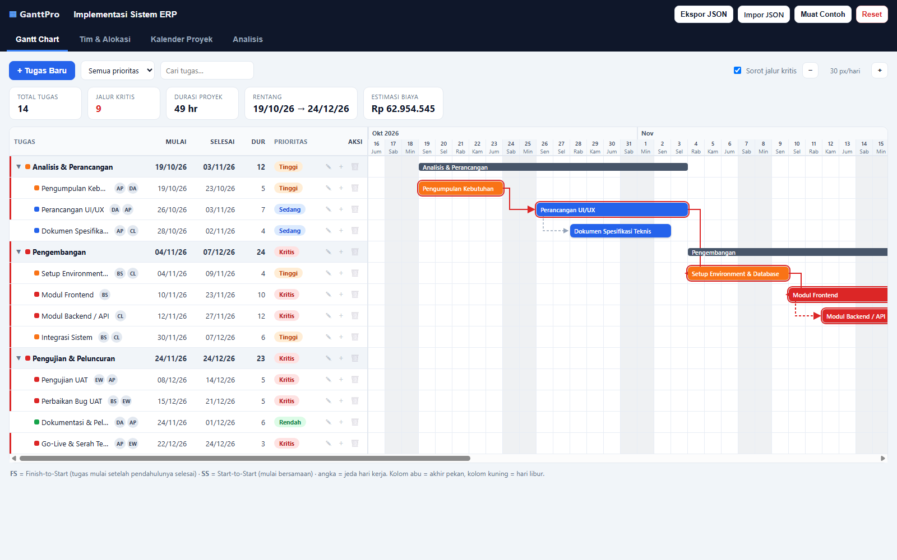
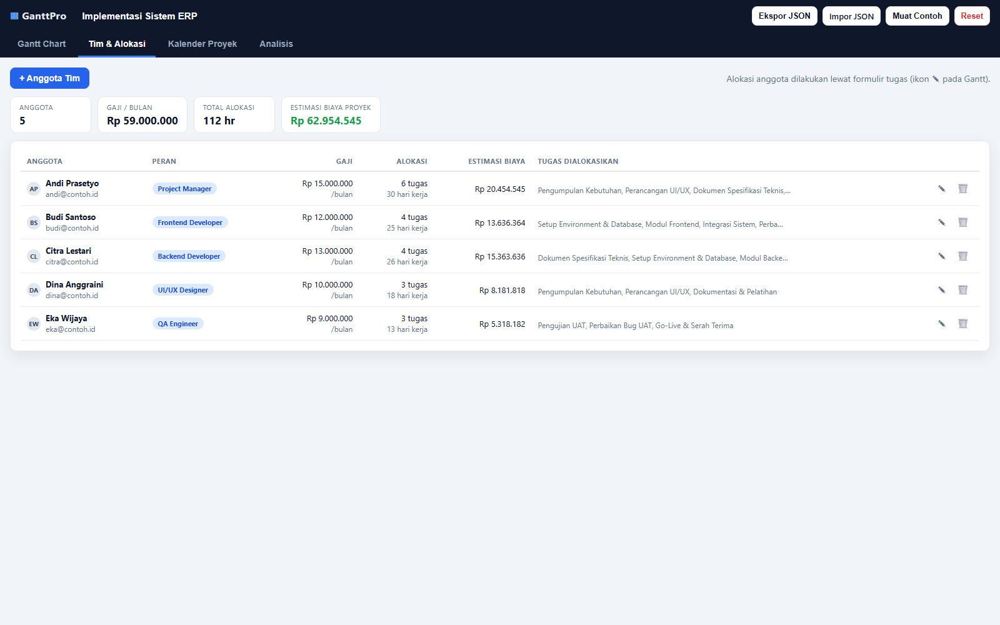
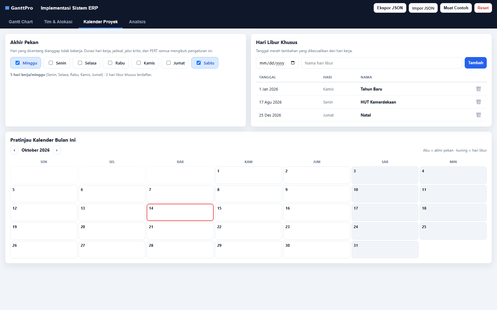
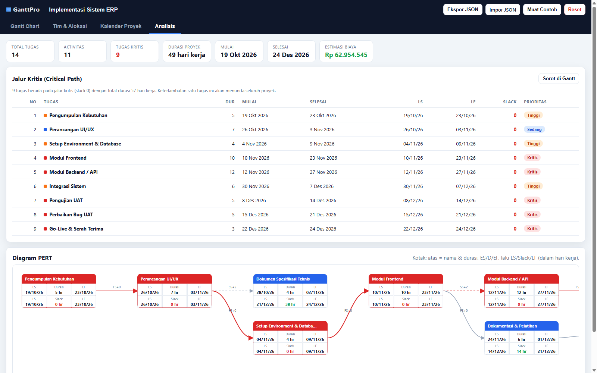

# GanttPro — Aplikasi Manajemen Proyek Gantt Chart

Aplikasi web **tanpa build step dan tanpa dependensi**: cukup buka `index.html` di browser
(Chrome/Edge/Firefox). Data tersimpan otomatis di `localStorage`.

## Fitur

| Modul | Fitur |
|---|---|
| **Task Management** | Tambah/ubah/hapus tugas, durasi dalam **hari kerja**, tanggal mulai, prioritas (Kritis/Tinggi/Sedang/Rendah), warna indikator (swatch + color picker), dan **sub-tugas (parent-child)** dengan baris ringkasan yang bisa dilipat. |
| **Predecessors & Timeline** | Hubungan antar tugas **FS (Finish-to-Start)** dan **SS (Start-to-Start)** beserta **jeda hari kerja (lag)**, ditampilkan sebagai grafik Gantt Chart dengan panah dependensi, kolom akhir pekan/hari libur, dan garis hari ini. |
| **Resource Management** | Pendaftaran anggota tim (nama, email, peran, gaji/bulan), alokasi anggota ke tugas lewat form tugas, rekap alokasi & estimasi biaya per anggota. |
| **Kalender Proyek** | Pengaturan hari akhir pekan (bisa dipilih per hari), penambahan **hari libur khusus**, dan pratinjau bulan. |
| **Analisis Proyek** | **Critical Path (CPM)** dengan slack/late dates + tabel jalur kritis, dan **diagram PERT** (ES/EF, LS/LF, slack per aktivitas). |

## Screenshot

Aplikasi sedang berjalan (diambil dari browser, ukuran jendela 1600×1000):

**Tab Gantt Chart** — bar tugas, panah dependensi, sorot jalur kritis:



**Tab Tim & Alokasi** — anggota tim, rekap alokasi & estimasi biaya:



**Tab Kalender Proyek** — akhir pekan, hari libur, pratinjau bulan:



**Tab Analisis** — statistik, tabel jalur kritis, diagram PERT:



## Cara Instalasi

Tidak ada dependensi yang harus dipasang (tanpa `npm install`):

```
git clone https://github.com/salsabilaaaaaaa081/Tugas-Freebuff-salsa.git
cd Tugas-Freebuff-salsa
```

Prasyarat hanya salah satu:

- **Browser modern** (Chrome/Edge/Firefox) — cukup buka `index.html`, atau
- **Node.js ≥ 18** — untuk server lokal `server.js` (tanpa unduhan paket), atau
- **Python 3** — alternatif `python -m http.server 8080`.

## Menjalankan

```
buka index.html          # langsung di browser, tanpa server
buka tests/tests.html    # menjalankan uji unit di browser
```

Atau lewat server lokal (hanya butuh Node.js — tanpa unduhan paket, script ada di `server.js`):

```
Windows  : double-click start-dev.bat      # server + buka browser otomatis
npm run dev              # lalu buka http://localhost:8080
PORT=3000 npm run dev    # port lain bila 8080 dipakai
```

Jika browser menolak `localhost` (kasus IPv6/proxy di Windows), buka `http://127.0.0.1:8080`
— server listen dual-stack dan menerima keduanya; log `[akses]` di terminal menandakan
permintaan benar-benar sampai.

Alternatif tanpa Node:

```
python -m http.server 8080    # lalu buka http://localhost:8080
```

## Struktur

```
index.html          # seluruh UI (tab, modal tugas & anggota)
css/styles.css      # tema, tabel, Gantt, PERT
server.js           # server statis bawaan Node untuk `npm run dev`
start-dev.bat        # Windows: double-click untuk menjalankan server + browser
js/utils.js         # utilitas tanggal (UTC), format, escape, unduh file
js/store.js         # model data, localStorage, data contoh proyek
js/schedule.js      # kalender hari kerja + mesin CPM (forward/backward pass)
js/gantt.js         # rendering Gantt Chart + panah dependensi
js/pert.js          # rendering diagram PERT (SVG)
js/tasks.js         # form tugas, predecessor, alokasi, pratinjau jadwal
js/resources.js     # CRUD anggota tim + rekap alokasi/biaya
js/calendar.js      # UI kalender proyek (weekend, hari libur, pratinjau)
js/analysis.js      # statistik proyek + tabel jalur kritis
js/app.js           # init, navigasi tab, event delegation, ekspor/impor
tests/tests.html    # uji unit yang bisa dibuka di browser
```

## Model penjadwalan

Semua perhitungan bekerja di ruang **indeks hari kerja** (indeks integer) lalu
dikonversi kembali ke tanggal kalender:

1. **Kalender kerja** — `weekendDays` (mis. Sabtu/Minggu) dan `holidays` menentukan
   hari kerja; `toIndex(tanggal)` membulatkan ke hari kerja berikutnya,
   `fromDate(indeks)` mengembalikan hari kerja ke-n.
2. **Forward pass** — `ES = max(tanggal mulai manual, batasan predecessor)`;
   `EF = ES + durasi - 1`. FS: `ES_penerus >= EF_pendahulu + 1 + lag`;
   SS: `ES_penerus >= ES_pendahulu + lag`.
3. **Backward pass** — `LF = finish proyek` (atau minimum dari batasan penerus),
   `LS = LF - durasi + 1`, **slack = LS - ES**. Slack 0 = **jalur kritis**.
4. **Sub-tugas** — baris induk adalah ringkasan (rollup min ES / max EF dari anak);
   predecessor yang menunjuk induk otomatis diperluas ke seluruh daun di bawahnya.
5. **Siklus** — jika ada dependensi melingkar, relasi bermasalah diabaikan dan
   peringatan ditampilkan di tab Analisis (jadwal tetap dihitung).

## Uji

Buka `tests/tests.html` di browser. 18 uji mencakup: durasi melewati akhir pekan,
hari libur, kustom weekend, `toIndex/fromDate`, aturan FS/SS + lag, slack jalur
kritis belah ketupat, rollup sub-tugas, penanganan siklus, batas tanggal manual,
estimasi biaya, dan validasi data contoh.

Status terakhir: **18 / 18 uji lulus** (dijalankan otomatis di Chrome headless
terhadap `http://127.0.0.1:8080/tests/tests.html`).

## Ekspor / Impor

Tombol **Ekspor JSON** mengunduh seluruh proyek; **Impor JSON** memulihkannya
(di tab mana pun). **Muat Contoh** memuat proyek demo, **Reset** menghapus semua data.
